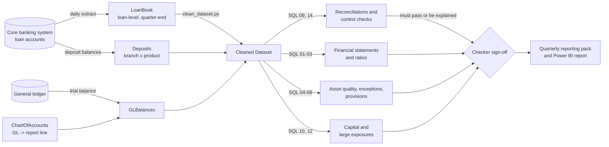

# Data Lineage

How each reported number travels from the source systems to the report. (Mermaid diagram: renders on GitHub.)

## Field-level lineage (examples)
| Reported item | Source field | Transformation |
|---|---|---|
| Gross advances | LoanBook.Outstanding | Sum at quarter-end; must agree with GL 1210 |
| Gross NPA | LoanBook.Outstanding, LoanBook.DPD | Sum where DPD > 90 (not the source AssetClass tag) |
| NPA provisions | LoanBook.ProvisionHeld | Sum where DPD > 90 |
| CASA % | GLBalances 2110, 2120, 2130 | (2110 + 2120) / (2110 + 2120 + 2130) |
| Net profit | GLBalances 4xxx, 5xxx | Income GLs - expense GLs over the financial year |
| Tier 1 | GLBalances 2010, 2020 | Share capital + reserves |
